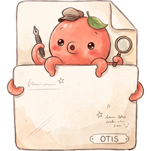

<p align="center"></p>

# Otis

A local Windows app with two parts. **Otis** the assistant lives in your Teams notes-to-self chat. It watches your inbox and calendar, posts alerts, reminders, and briefs, and answers your messages. The **dashboard** is a browser window with a To-do tab, a Notes tab with an embedded Claude editor, and a Streams tab for tracking papers and projects.

Everything runs on your own PC. The AI is Claude, used through the Claude Code command-line tool and your own Claude subscription, so there is no API key and no separate billing. Mail and calendar are read through the Microsoft 365 connector in your Claude account. Otis never sends email, never changes your calendar, and never messages anyone but you.

## What it does

- **Mail.** Scans new inbox mail at :00, :15, :30, and :45 during working hours and posts the items that need you as a numbered list. Ask about an item by number ("what does 1 want", "make a todo from 1 by friday"). FYI items arrive in two batches a day. Emails you have not answered come back at the noon and 4 PM roundups, at most twice each.
- **Calendar.** A morning brief with the day's meetings and your to-dos for today and this week, a prep prompt before meetings with other attendees, and event requests that return a pre-filled Outlook-on-the-web link. You review and press Save or Send yourself.
- **To-do.** Add, check off, delete, date, and nest items from chat or the dashboard. Items made from email keep an Open email button.
- **Notes.** One page per topic. Otis files quick notes and meeting notes here. The Claude panel edits the selection in place, with undo, or brainstorms about the page.
- **Streams.** Pipeline tracker for papers and projects, with stage, due date, next action, a court badge for who holds the ball, and an activity LED you can set by hand.
- **Pop-ups.** Teams does not notify you for messages you post to yourself, so Otis shows a Windows pop-up from the tray icon for reminders, meeting prompts, and emails that need you.
- **Commands.** Type `help` in the self-chat for the full list.

## Installing

Run **Otis-Setup.exe**. The wizard checks for Chrome or Edge and Claude Code (and installs Claude Code for you), tests your Claude sign-in, asks a few questions about you, and installs into one folder you choose. Choose a folder inside OneDrive to carry your data between PCs.

Setup can also import an earlier Otis folder or restore a daily backup. It is safe to run again to update: your data and settings stay in place. To uninstall, use Apps in Windows Settings.

Also needed, outside Setup: the **Microsoft 365 connector** turned on in your Claude account (claude.ai, Settings, Connectors; read access is enough) and Teams access to your own self-chat. The first time Otis starts, a Teams window opens. Sign in once and it hides again.

## What lives where

Everything Otis owns sits in the install folder:

```
Otis.exe          launcher
Uninstall.exe     uninstaller (also listed in Windows Settings)
settings.json     your settings
app\              the program
data\             to-dos, notes, the assistant's state, streams.json, logs
```

Two things sit outside it. The Teams sign-in profile lives in `%LOCALAPPDATA%\Otis\teams-profile` because it is a browser profile that must not sync. Shortcuts live in your Start menu, and on the desktop and Startup folder if you chose them.

## Settings

Personal values live in `settings.json` (see `settings.example.json`). Restart Otis from the tray menu after changing it.

| Setting | Meaning |
|---|---|
| `UserName`, `UserDescription`, `UserEmail` | How Otis addresses you and gives Claude context |
| `Contacts` | Nicknames, such as `"sam": "sam@example.org"` |
| `SecretaryModel` | Model for chat answers (`haiku` is fastest) |
| `SecretaryThinkModel` | Model for scans, note clean-up, and the Notes editor (`sonnet`) |
| `SecretaryDays`, `SecretaryStart`, `SecretaryEnd` | Working hours for scans, nudges, and alerts |
| `SecretaryMaxCallsPerDay` | Daily cap on Claude calls (250) |
| `StreamsPath`, `StreamsRoot` | The Streams file (default `data\streams.json`) and the folder each stream's path starts from |
| `BackupPath` | Folder for a daily copy of your data, with two weeks of dated copies. Blank means no backup. |
| `TeamsProfileDir` | Where the Teams window keeps its browser profile |
| `BotEmojiCode` | Custom Teams emoji at the start of Otis's messages, `:otis:` by default. Set `""` for the standard emoji. |
| `ToastAlerts` | `true` shows Windows pop-ups for reminders, meeting prompts, and emails that need you |
| `MinimizeToTray` | `true` hides the window when minimized; the tray icon restores it |
| `Port` | Local port, 8000 by default |

## Everyday use

The tray icon runs the app. Double-click opens Otis. Right-click offers Open Otis, View log, Pause Otis, Show Teams window, Start with Windows, Restart Otis, and Exit. Restart Otis after changing any `.ps1` file. Edits to `Index.html` need only a browser refresh.

## Privacy

- The server listens on `localhost` only.
- Email and calendar text goes to Claude through your own account when scans, briefs, and questions run. Check that this fits your organization's data policy.
- `data\` and `settings.json` hold personal content and are excluded from Git.

## Troubleshooting

- **No replies in Teams:** open the log from the tray menu. A sign-in prompt in Otis's Chrome window needs your attention.
- **"Claude's sign-in expired":** open a terminal, run `claude`, then type `/login`. Use the browser profile signed in to the account with your Claude plan. Otis retries every 15 minutes on its own.
- **Mail scan fails with a Microsoft sign-in error:** re-authorize the Microsoft 365 connector in your Claude account.
- **"Otis did not start":** check `data\server.log`. Some IT policies block PowerShell scripts.

## Building the installer (developers)

```
installer\build.cmd
```

This compiles `dist\Otis-Setup.exe` with the C# compiler included in Windows. It packs `app\` (without `tests\` and icon sources), builds `Otis.exe` from `app\launcher.cs`, and embeds `settings.example.json`. Bump `installer\VERSION` for a release. Run `app\tests\assistant-tests.ps1` first.

```
app/                 program: server.ps1, Index.html, assistant/, lib/, icons/, launcher.cs, tests/
installer/           Setup source (Engine.cs, Wizard.cs, Main.cs), build.ps1, VERSION
docs/                command reference
settings.example.json  template embedded in Setup
```
